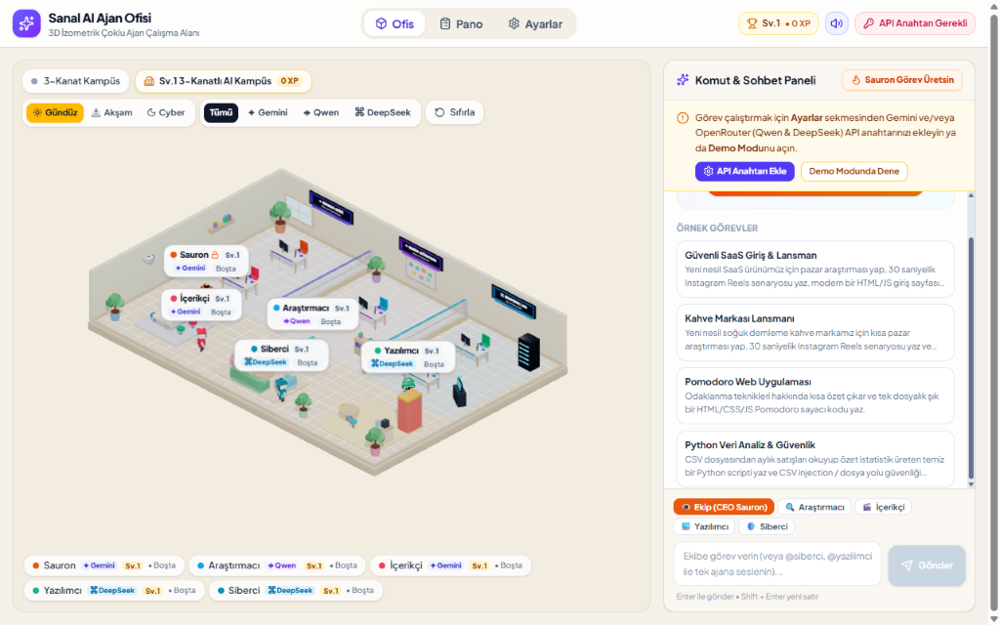
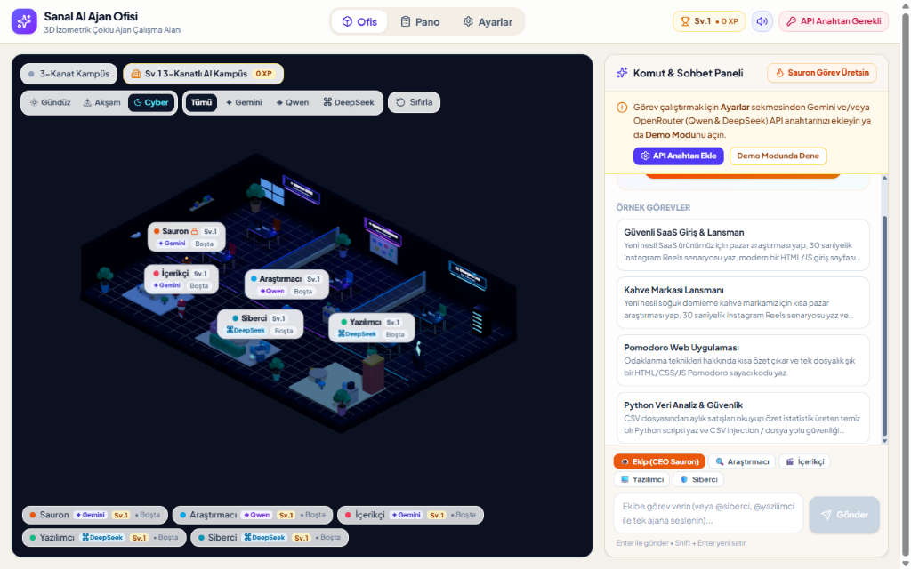
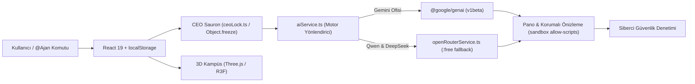

# 🏢 3D Sanal AI Ajan Ofisi

[](https://github.com/Suats7/sanal-ofis/actions/workflows/sauron-guard.yml)
[](https://github.com/Suats7/sanal-ofis/actions/workflows/unit-tests.yml)
[](https://suats7.github.io/sanal-ofis/)

🌐 **Canlı Demo:** **[https://suats7.github.io/sanal-ofis/](https://suats7.github.io/sanal-ofis/)**

**Gemini Ofisi**, **Qwen Stüdyosu** ve **DeepSeek Lab** kanatlarından oluşan 3 boyutlu izometrik çoklu-ajan AI çalışma kampüsü.

## 📸 Ekran Görüntüleri

| Gündüz (Day) Teması | Gece (Night Cyber) Teması |
| :---: | :---: |
|  |  |

## 🏗️ Sistem Mimarisi & Veri Akışı



- **Durum ve Gizlilik Sınırı (`App.tsx` + `localStorage`):** Uygulama arka uç sunucusu olmadan çalışır; API anahtarları, görev geçmişi, sohbetler ve XP ilerlemesi yalnızca kullanıcının kendi tarayıcısında tutulur.
- **Kilitli Yönetici ve 3D Sahne (`ceoLock.ts`, `agents.ts`, `OfficeScene.tsx`):** CEO Sauron kimliği çalışma zamanında `Object.freeze` ve `assertSauronIntegrity` ile sabitlenir; React Three Fiber sahnesi `Gündüz / Akşam / Cyber` temalarını, veri ışınlarını ve kamera odağını yönetir.
- **Çoklu Motor Yönlendirme (`aiService.ts`, `geminiService.ts`, `openRouterService.ts`):** Görevleri paralel (`Promise.allSettled`) veya sıralı olarak ilgili API'ye iletir; emekli model adlarını otomatik göç ettirir (`normalizeGeminiModel`, `normalizeOpenRouterModel`) ve geçici hatalarda aktif alternatif modellere düşer.
- **Sandbox ve CI/CD Koruması (`MarkdownCard.tsx`, `verify-sauron.mjs`, `.github/`):** Üretilen HTML önizlemeleri `sandbox="allow-scripts"` (`allow-same-origin` kapalı) iframe ile izole edilir; GitHub Actions (`sauron-guard` ve `deploy-pages`) her PR'da kimlik bütünlüğünü ve derlemeyi doğrulayıp `main` dalını canlıya alır.

## ✨ Öne Çıkan Özellikler

- **🔒 Kilitli CEO Sauron (`src/constants/ceoLock.ts`)**: Ofisin baş yöneticisi **Sauron**, çalışma zamanında `Object.freeze` + `assertSauronIntegrity` ile ve GitHub tarafında otomatik CI kontrolüyle korunur. Kendi başına görev üretebilir (`Sauron Görev Üretsin`) ve ekibi koordine eder.
- **🛡️ 5 Uzmanlı Tam Kadro**:
  - **Sauron** (`CEO`) — Stratejik planlama, otonom görev başlatma
  - **Araştırmacı** (`◈ Qwen`) — Pazar, trend ve hedef kitle analizi
  - **İçerikçi** (`✦ Gemini`) — Reels/Shorts senaryoları, kanca başlıklar, metin yazarlığı
  - **Yazılımcı** (`⌘ DeepSeek`) — HTML, CSS, JS, React, TypeScript ve Python geliştirme
  - **Siberci** (`⌘ DeepSeek`) — OWASP Top 10, XSS/CSRF/CSP güvenlik denetimi ve sertleştirme
- **🌆 Dinamik 3D Atmosfer (`Gündüz` / `Akşam` / `Cyber`)**: Tek tıkla gün ışığı, altın günbatımı veya neon ışıklı Gece Cyber temasına geçiş; CEO Sauron masasından aktif kanatlara uçan 3D görev veri ışınları ve yumuşak geçişli kamera odağı.
- **▶ Korumalı Canlı HTML Önizleme**: Yazılımcı ajanının ürettiği HTML/JS prototiplerini doğrudan uygulama içindeki `sandbox="allow-scripts"` iframe penceresinde canlı çalıştırma.
- **🎯 Doğrudan 1-e-1 `@Ajan` Mesajlaşma**: İster tüm ekibe (CEO Sauron), ister doğrudan `@siberci`, `@yazilimci`, `@arastirmaci`, `@icerikci` ajanına tek tıkla görev gönderme.
- **📊 Yönetici Analitiği, Siberci Güvenlik Radarı & Ses Efektleri**: AI motor dağılımı, denetlenmemiş çıktılar için tek tık Siberci denetimi, tüm görevi tek `.md` raporu olarak indirme ve Web Audio API ofis sesleri.

## 🚀 Kurulum & Çalıştırma

```bash
npm install
npm run dev
```

Doğrulama, birim testleri ve üretim derlemesi:

```bash
npm run verify:sauron
npm test
npm run build
```

> **Not:** API anahtarlarınız (Google AI Studio / OpenRouter) yalnızca kendi tarayıcınızın `localStorage` alanında saklanır; depoya veya harici bir sunucuya yazılmaz.

## 🔒 CEO Sauron Koruma & CI/CD Kuralları

- `.github/CODEOWNERS` dosyası kritik yönetici dosyalarını (`ceoLock.ts`, `agents.ts`, `verify-sauron.mjs`, `sauron-guard.yml`) **`@Suats7`** onayına kilitler.
- `main` dalı branch ruleset ile korunur: doğrudan push/force-push kapalıdır; her değişiklikte `sauron-guard` doğrulama ve üretim derlemesi zorunludur.
- `main` dalına birleşen her değişiklik `.github/workflows/deploy-pages.yml` üzerinden otomatik olarak GitHub Pages'e yayınlanır.
